# Beese's Blackjack

**Arcade blackjack for a Raspberry Pi 4 cabinet.**
A six-deck Vegas Strip table in the neon honey lounge of
[Beese's Poker Lounge](https://github.com/cael-beese/Poker) and
[Beese's WILD 7'S](https://github.com/cael-beese/wild-7s): you and four bee
regulars against the dealer, with an exact strategy hint, Perfect Pairs and
21+3 side bets, and the HONEY POT progressive. It's written in C with
raylib. The shuffles and odds are real, and the credits are free-play only.

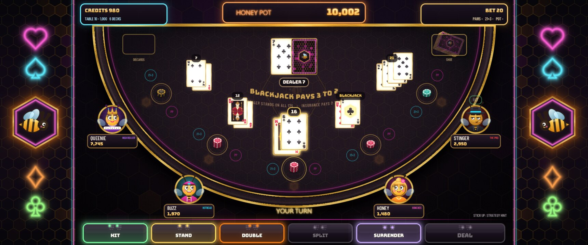

- **Vegas Strip rules**: six decks, the dealer stands on soft 17 and peeks for
  blackjack, blackjack pays 3 to 2, double on any two cards and after a
  split, split to four hands, late surrender, insurance. Basic strategy
  returns **99.6%** (measured over 300,000 rounds)
- **An exact strategy hint**: it works out the expected value of every play
  your hand allows against the dealer's up card, and lights the best one. It
  agrees with the published six-deck chart on all 300 two-card decisions
- **The bee regulars**: Stinger plays by the book, Honey never risks a bust,
  Buzz lets his wins ride, Queenie bets big and insures everything, and
  Drone plays like the dealer. They come and go as their chips do
- **Side bets with their real paytables**: Perfect Pairs (25 / 12 / 6, a
  93.89% return) and 21+3 (100 / 40 / 30 / 10 / 5, 95.38%)
- **The HONEY POT**: 5 credits a hand on sevens; three suited sevens take the
  pot, which every bet at the table feeds and the save file keeps. It plays
  out as a full takeover, and the table waits for it
- **Built for the cabinet**: the 1280x720 game is shown 2x on a 3440x1440
  ultrawide, with the side art in the margins. It runs as its own RetroPie
  Port, keeps power-cut-safe saves, and has an operator's service menu

---

## Screenshots

| | |
|---|---|
| 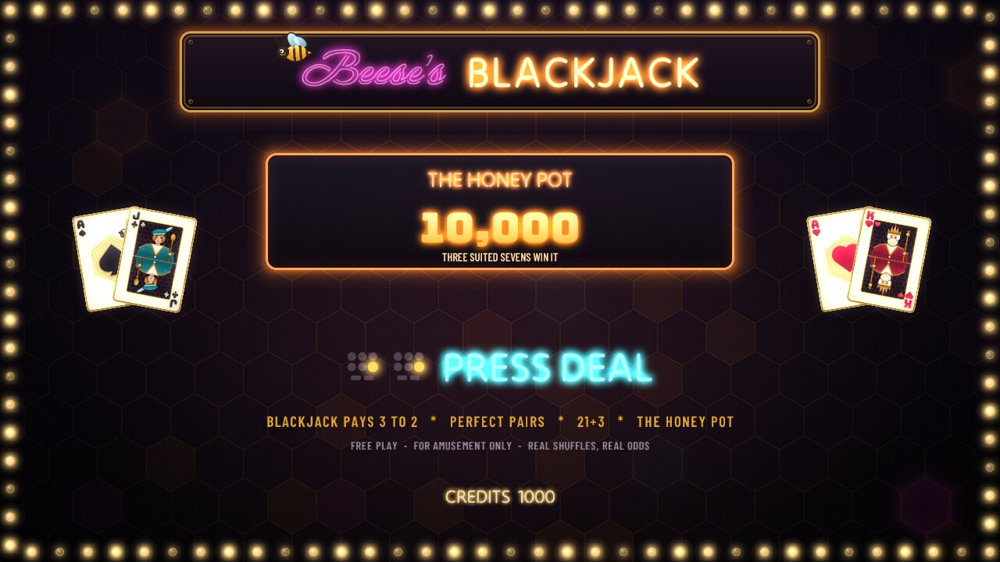 | 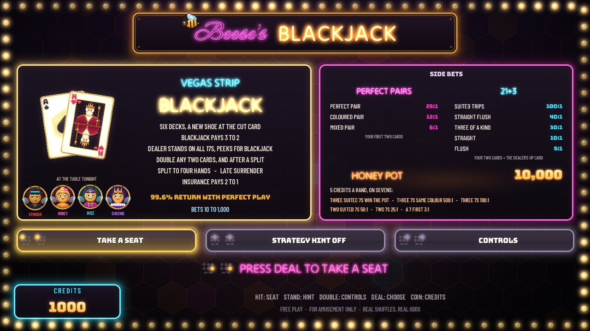 |
| **Attract**: the title and the HONEY POT between players | **The lobby**: the rules, the side bets and the regulars |
| 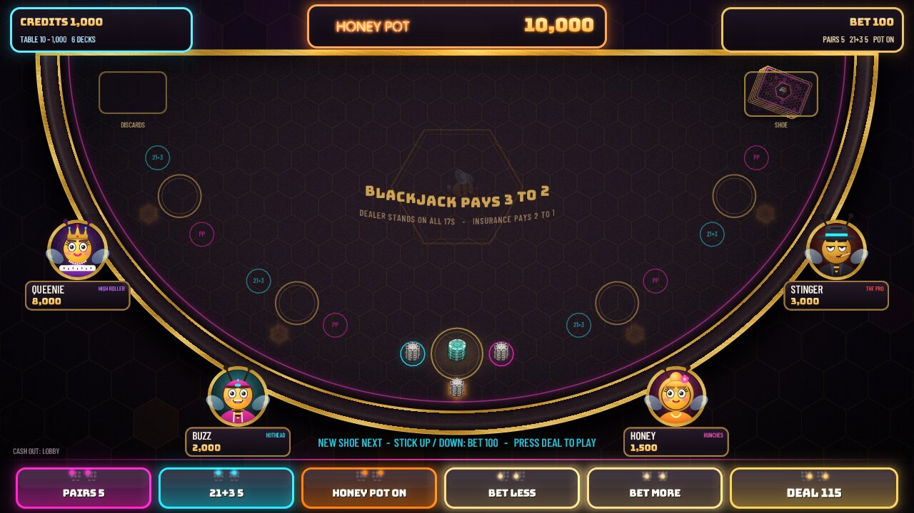 | 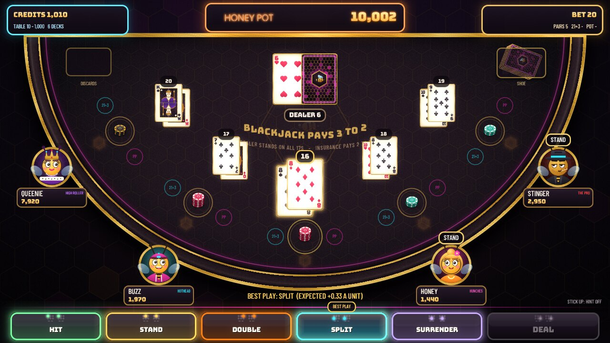 |
| **Betting**: every side bet on, each button labelled | **The hint**: 8-8 against a 6, split |
| 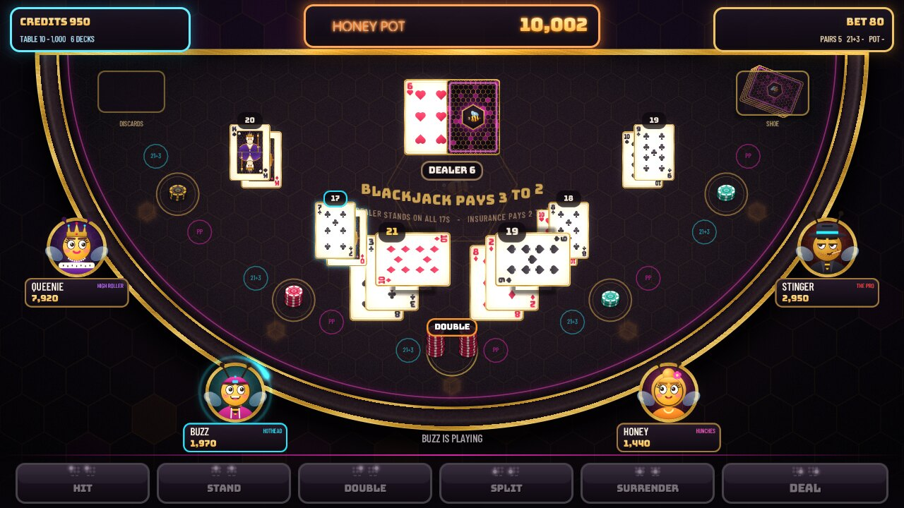 | 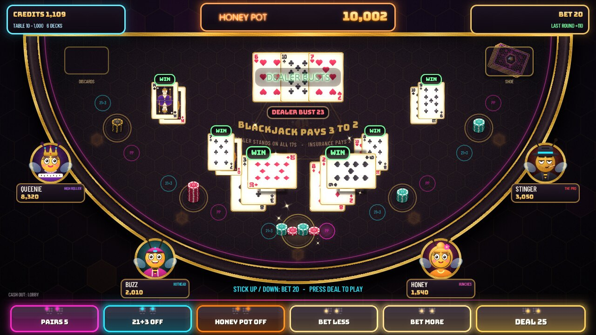 |
| **Doubled after the split** | **The dealer busts** |
| 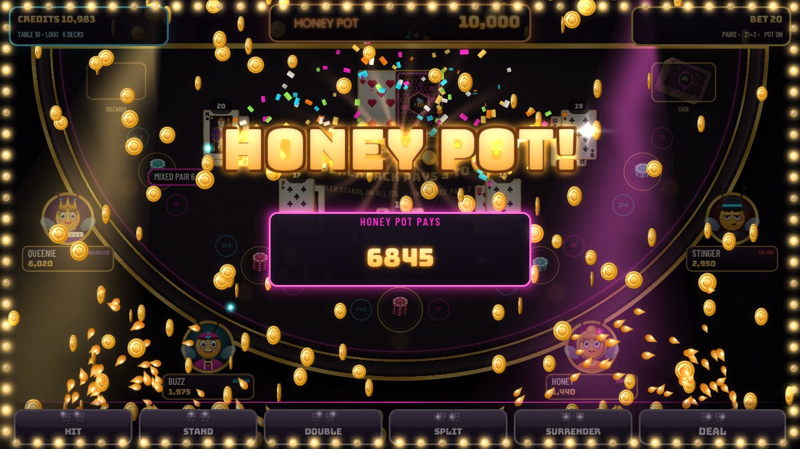 | 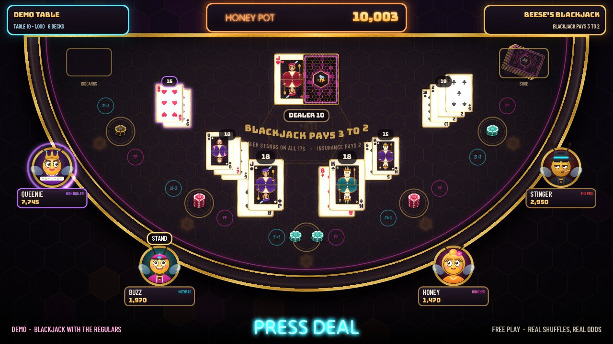 |
| **The HONEY POT**: three suited sevens | **The demo**: the regulars play a real round |
| 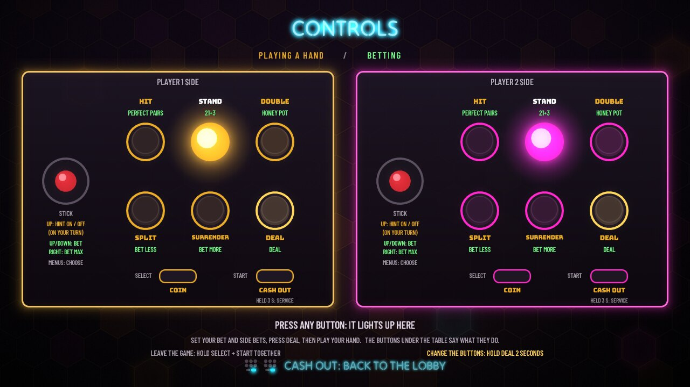 | 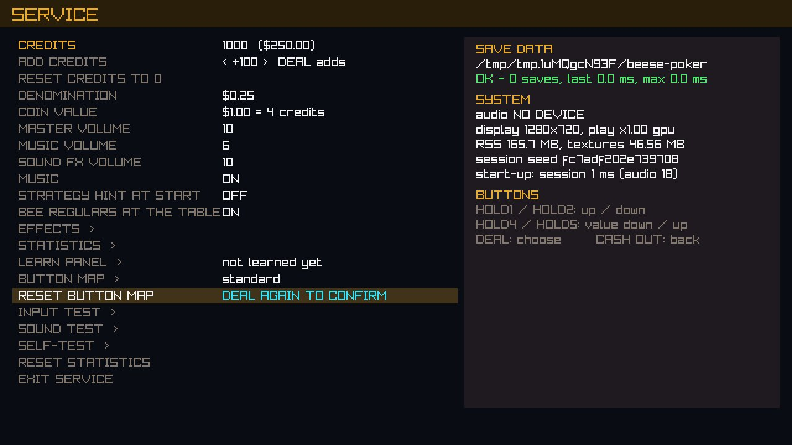 |
| **CONTROLS**: the whole panel, lit as you press | **LEARN PANEL**: the game learns how your panel is wired |

*Screenshots are the game's own frames, rendered headlessly from scripted
button presses with `tools/readme_shots.sh`.*

---

## Controls

The panel has, on each side, a stick, two rows of three buttons, and SELECT
and START. It is a one-player game, and **both sides are laid out alike**, so
whoever plays uses one side only:

```
              EITHER SIDE  (Y X L over B A R)
          ( )     [  HIT  ]  [ STAND ]  [ DOUBLE ]
         stick    [ SPLIT ]  [SURRNDR]  [  DEAL  ]
                  SELECT = COIN      START = CASH OUT  (hold 3 s = SERVICE)
         stick up / down = bet more / less, right = the largest bet
```

| Control | Betting | Playing a hand |
|---|---|---|
| HIT | Perfect Pairs: off, 5, 10, 25, 50 | hit (insurance: yes) |
| STAND | 21+3: off, 5, 10, 25, 50 | stand (insurance: no) |
| DOUBLE | HONEY POT on / off | double down |
| SPLIT | bet less | split a pair |
| SURRENDER | bet more | late surrender |
| DEAL | deal (the bets are taken now) | |
| stick | up / down: the bet; right: the largest bet | up: strategy hint on / off |
| START | CASH OUT: back to the lobby (between rounds); held 3 s: service menu | |
| SELECT | COIN: adds credits | |
| SELECT + START | leave the game, back to EmulationStation (held together) | |

In the lobby, HIT takes a seat, STAND turns the hint on or off, and DOUBLE
opens the CONTROLS page. **You never have to remember this**: every button on
screen carries a small drawing of the panel with its place lit, and its
label changes with what it does now.

**Setting up a cabinet: LEARN PANEL.** Which wire of the encoder is in which
position depends on how a panel was built. On its first start the game
offers to learn it; the same wizard is in the service menu (hold START for
3 seconds). Until then it assumes RetroPie's usual layout (Y X L over
B A R). **BUTTON MAP** (DEAL held 2 seconds on the CONTROLS page) lets a
player put each function where they like. Both are saved in the game's own
save folder; nothing is shared with the other cabinet games.

**On a keyboard** (the desktop build): HIT to SURRENDER are `1`-`5` (or
`Z X C V B`), DEAL is `Enter`/`Space`, CASH OUT `Q`, COIN `Insert`, SERVICE
`F2`. The arrows are the stick, `F1` shows the performance overlay, and
`Esc` quits.

---

## Install on a RetroPie cabinet

On the Pi, with RetroPie (tested on Debian 13; the installer also handles
Raspberry Pi OS Bookworm):

```sh
git clone https://github.com/cael-beese/blackjack.git BeeseBlackjack
cd BeeseBlackjack
./install.sh --dry-run     # shows what it would do
./install.sh
```

It installs any missing build packages, builds raylib 5.5 with our patches
and then the game, and installs it to `/opt/beese-blackjack`. It adds
**Beese's Blackjack** under Ports and touches no other port's files. Saves
live in `~/.local/share/beese-blackjack`. `./install.sh --uninstall` removes
it. Restart EmulationStation to see the new entry.

## Build on a desktop (Linux / WSL)

```sh
tools/fetch_raylib.sh desktop
cmake -S . -B build -DBPL_PLATFORM=DESKTOP
cmake --build build -j
ctest --test-dir build
build/platform/beese-blackjack
```

## Measured on the cabinet

Pi 4, 3440x1440 display, everything on (docs/PLATFORM.md section 9b):

| | measured | budget |
|---|---|---|
| attract, lobby, a full table, the HONEY POT takeover | 60 fps, 1% low 58.8-59.1, at most 1 missed frame a minute | 1% low >= 55 |
| memory | 83-86 MB in every mode | <= 150 MB |
| textures | 43 MB | <= 64 MB |
| draw calls | 6-8 a frame | < 100 |
| start to attract | 1.2 s warm; 4.5 s from a cold page cache | <= 4 s |

## Documentation

- [docs/SPEC.md](docs/SPEC.md): what the game is, its rules and its returns
- [docs/CONTRACT.md](docs/CONTRACT.md): how it fits together (engine, game, presentation, honesty)
- [docs/SYSTEMS.md](docs/SYSTEMS.md): flow, credits, saves, service menu, attract, install
- [docs/PLATFORM.md](docs/PLATFORM.md): build, display, input, tools, measuring

The platform layer (display, input, panel, saves, audio, the render kit) is
shared with Beese's Poker Lounge, from which this game was started.

## License

Source-available, free for noncommercial use under the
[PolyForm Noncommercial License 1.0.0](LICENSE.md). **Any commercial use,
in whole or in part, requires written permission** from the copyright
holder; to ask, open an issue on this repository. raylib and the fonts keep
their own licenses (see LICENSE.md and CREDITS.md).
